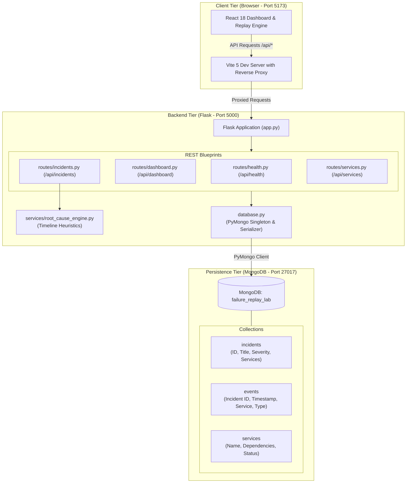

# Failure Replay Lab — Cloud Incident Investigation & Recovery Platform

> **A full-stack, developer-first post-mortem investigation and incident replay platform.**  
> Built for software engineers, site reliability engineers (SREs), and DevOps teams to simulate, reconstruct, visualize, and analyze distributed microservice outages step-by-step.

---

## Table of Contents
1. [Problem Statement](#problem-statement)
2. [Project Overview](#project-overview)
3. [Key Features](#key-features)
4. [System Architecture](#system-architecture)
5. [Technology Stack & Rationale](#technology-stack--rationale)
6. [MongoDB Database Design](#mongodb-database-design)
7. [Project Folder Structure](#project-folder-structure)
8. [Prerequisites](#prerequisites)
9. [Quick Start (Local Windows Setup)](#quick-start-local-windows-setup)
   - [Method 1: One-Click Startup Script (Recommended)](#method-1-one-click-startup-script-recommended)
   - [Method 2: Manual Terminal Startup](#method-2-manual-terminal-startup)
10. [Docker & Docker Compose Setup](#docker--docker-compose-setup)
11. [REST API Documentation](#rest-api-documentation)
12. [How "Replay This Failure" Works](#how-replay-this-failure-works)
13. [How the Root-Cause Analysis Engine Works](#how-the-root-cause-analysis-engine-works)
14. [Testing & Verification](#testing--verification)
15. [SRE Architectural Guide & Engineering Deep Dive](#sre-architectural-guide--engineering-deep-dive)
16. [Limitations & Future Roadmap](#limitations--future-roadmap)

---

## Problem Statement

When high-severity incidents strike modern distributed applications, engineering teams face significant challenges:
- **Alert Fatigue & Noise:** Thousands of cascading log lines and metric alerts fire simultaneously across dozens of services.
- **Hidden Failure Origins:** Downstream services (e.g., API Gateway, Frontend) display catastrophic `500 Internal Server Error` banners, obscuring the fact that an upstream service (e.g., database connection pool exhaustion or cache cluster crash) triggered the collapse.
- **Difficulty Reconstructing the Timeline:** Post-mortem analysis requires manually correlating UTC timestamps from disparate log aggregators.
- **Lack of Visual Feedback:** Incident responders cannot easily step backward and forward in time to observe how a failure propagated through service dependencies.

**Failure Replay Lab** solves this problem by providing an interactive **Time Machine for Software Incidents**. It chronologically sequences incident events, animates service topology states dynamically during playback, and applies deterministic heuristics to isolate the root cause.

---

## Project Overview

Failure Replay Lab allows developers and operations teams to:
1. **Reconstruct Outages in Real Time:** Use playback controls (Play, Pause, Restart, Previous, Next, Speed 1x/2x/5x, and Scrubber) to observe how individual metric anomalies escalate into cascading failures.
2. **Visualize Architecture Degradation:** Watch an SVG-based microservice dependency graph dynamically transition node statuses between `Healthy`, `Degraded`, `Failed`, and `Affected`.
3. **Automate Root-Cause Deductions:** Heuristically distinguish between the *Earliest Recorded Symptom*, the *First Observed Service Failure*, and the *Suspected Root Cause*.
4. **Compare Two Outages Side-by-Side:** Evaluate blast radius, overlapping impacted tiers, event sequence differences, and recovery actions.
5. **Simulate Service Failures:** Test architecture resilience and observe cascade behavior interactively from the UI.

---

## Key Features

- **Replay Lab (The Time Machine):** Full playback engine with scrubber seeking, 1x/2x/5x speed modifiers, active step telemetry inspector, and synchronized topology state changes.
- **Dynamic Microservice Topology:** Interactive SVG graph mapping 6 tiers (`Frontend`, `API Gateway`, `Authentication Service`, `Order Service`, `Cache Service`, `Database`).
- **Rule-Based Root-Cause Engine:** Transparent Python post-mortem module matching failure patterns without third-party black-box AI dependencies.
- **Side-by-Side Incident Comparison:** Deep differential comparison matrix highlighting shared vs. unique affected services and recovery metrics.
- **Aggregated Executive Dashboard:** Dynamic KPI cards, severity distribution charts, status breakdown, and recent incident feeds calculated directly from MongoDB.
- **Full RESTful CRUD API:** Endpoints to create, inspect, update, filter, search, and delete incidents and services with schema validation.
- **Clean SRE Documentation:** Explains state machines, PyMongo connection pooling, BSON serialization, and timer cleanup.

---

## System Architecture



---

## Technology Stack & Rationale

| Layer | Technology | Version | Rationale & Why Chosen |
|---|---|---|---|
| **Frontend UI** | **React** | `18.3.1` | Component-based architecture, declarative state machine for playback scrubber and timer management. |
| **Build Tool** | **Vite** | `5.4.11` | Instant hot-module replacement (HMR), fast development server, native ES modules. |
| **Icons** | **Lucide React** | `1.16.0` | Clean, modern developer-tool icon set with semantic status indicators. |
| **Styling** | **Custom CSS** | Vanilla CSS | Developer dark theme with custom CSS variables, responsive grids, and zero heavyweight runtime CSS overhead. |
| **Backend Server** | **Python Flask** | `3.1.0` | Lightweight REST API framework, simple request lifecycle, transparent routing blueprints. |
| **CORS** | **Flask-CORS** | `5.0.0` | Enables secure cross-origin communication between Vite (5173) and Flask (5000). |
| **Database Driver** | **PyMongo** | `4.10.1` | Native MongoDB driver for Python with connection pooling and BSON object handling. |
| **Database** | **MongoDB** | `8.0 / Atlas` | Document-oriented NoSQL database ideal for semi-structured incident event payloads and telemetry details. |
| **Testing** | **pytest** | `8.3.4` | Industry-standard Python testing suite verifying all API routes, filters, and rule engine logic. |
| **Containerization** | **Docker Compose** | `v2 / v5` | Multi-container composition supporting MongoDB, Flask, and Vite. |

---

## MongoDB Database Design

Database Name: `failure_replay_lab`

### 1. `incidents` Collection
Stores metadata for each simulated or user-created outage.
```json
{
  "_id": "ObjectId('...')",
  "incident_id": "INC-2024-001",
  "title": "Database Connection Pool Exhaustion Under Peak Load",
  "description": "A surge in unindexed queries consumed all connection slots...",
  "severity": "critical",
  "status": "resolved",
  "started_at": "2024-10-12T14:10:00Z",
  "ended_at": "2024-10-12T14:32:00Z",
  "affected_services": ["Database", "Order Service", "API Gateway", "Frontend"],
  "suspected_root_cause": "Long-running unindexed queries held connections indefinitely...",
  "recovery_action": "Terminated rogue queries and increased pool size from 100 to 250."
}
```
**Indexes:** `incident_id` (Unique index, ascending)

---

### 2. `events` Collection
Stores individual chronological occurrences during an incident.
```json
{
  "_id": "ObjectId('...')",
  "event_id": "EVT-001-01",
  "incident_id": "INC-2024-001",
  "timestamp": "2024-10-12T14:10:00Z",
  "service_name": "Database",
  "event_type": "metric_anomaly",
  "severity": "warning",
  "description": "Database query latency increases from 12ms baseline to 480ms.",
  "details": {
    "metric": "query_latency_ms",
    "value": 480,
    "threshold": 50
  }
}
```
**Indexes:**
- `event_id` (Unique index, ascending)
- Compound: `(incident_id: 1, timestamp: 1)` for high-performance chronological timeline queries.

---

### 3. `services` Collection
Stores registered microservices and their topology dependencies.
```json
{
  "_id": "ObjectId('...')",
  "service_name": "Order Service",
  "description": "Order processing and checkout coordination",
  "dependencies": ["Database", "Cache Service"],
  "status": "healthy"
}
```
**Indexes:** `service_name` (Unique index, ascending)

---

## Project Folder Structure

```
failure-replay-lab/
├── README.md                          # Comprehensive project documentation
├── start-all.bat                      # One-click Windows launcher (starts DB check, Backend & Frontend)
├── start-backend.bat                  # Starts Flask Backend on port 5000
├── start-frontend.bat                 # Starts React Frontend on port 5173
├── stop-all.bat                       # Safely stops running backend and frontend processes
├── docker-compose.yml                 # Multi-container orchestration (MongoDB + Flask + React)
├── .dockerignore                      # Docker ignore rules
├── .gitignore                         # Secret exclusion & node/python cache ignore
├── backend/
│   ├── app.py                         # Flask entrypoint, blueprint registry, CORS & error handlers
│   ├── database.py                    # PyMongo connection, BSON serializer, index initializer
│   ├── seed_data.py                   # Idempotent database seeder with 5 realistic simulated outages
│   ├── Dockerfile                     # Container definition for Flask backend
│   ├── requirements.txt               # Backend dependencies (Flask, PyMongo, python-dotenv, pytest)
│   ├── .env                           # Local environment config (MONGODB_URI, PORT, DB_NAME)
│   ├── .env.example                   # Example template for environment configuration
│   ├── .gitignore                     # Backend gitignore for .env and caches
│   ├── routes/
│   │   ├── health.py                  # GET /api/health (Database ping & count metrics)
│   │   ├── dashboard.py               # GET /api/dashboard (Aggregated KPIs, recovery time, charts)
│   │   ├── incidents.py               # CRUD endpoints for incidents, events, and analysis
│   │   └── services.py                # CRUD endpoints for microservices and dependency graph
│   ├── services/
│   │   └── root_cause_engine.py       # Deterministic rule engine for post-mortem analysis
│   └── tests/
│       ├── test_api.py                # pytest integration suite for all REST endpoints
│       └── test_analysis.py           # pytest unit tests for timeline parser and rule heuristics
└── frontend/
    ├── package.json                   # React 18, Vite 5, Lucide-React, Recharts
    ├── Dockerfile                     # Container definition for React Vite frontend
    ├── vite.config.js                 # Proxy config forwarding /api to http://127.0.0.1:5000
    ├── index.html                     # HTML5 shell with Inter and JetBrains Mono typography
    └── src/
        ├── App.jsx                    # Root view coordinator and navigation router
        ├── main.jsx                   # React DOM entrypoint
        ├── index.css                  # Developer dark theme design system & SVG animations
        ├── services/
        │   └── api.js                 # Centralized fetch API wrapper with error handling
        ├── components/
        │   ├── Navbar.jsx             # Top bar with MongoDB live pulse heartbeat pill
        │   ├── DependencyGraph.jsx    # Interactive SVG dependency diagram with animated edges
        │   ├── SeverityBadge.jsx      # Semantic status badges (Critical, High, Medium, Low)
        │   ├── StatusBadge.jsx        # Badges for Open, Investigating, Resolved
        │   ├── ServiceStatusBadge.jsx # Badges for Healthy, Degraded, Failed, Affected
        │   ├── ServiceModal.jsx       # Modal inspecting individual service telemetry & history
        │   └── CreateIncidentModal.jsx# Form modal to create simulated incidents with validation
        └── pages/
            ├── OverviewPage.jsx       # KPIs, severity bars, topology summary, recent incidents
            ├── IncidentsPage.jsx      # Search, filter by severity/status, CRUD incident table
            ├── IncidentDetailsPage.jsx# Incident overview, RCA diagnostic report, event timeline
            ├── ReplayLabPage.jsx      # The Time Machine (Scrubber, 1x/2x/5x speed, SVG sync)
            ├── DependencyMapPage.jsx  # Architectural topology map & interactive failure simulator
            ├── CompareIncidentsPage.jsx# Side-by-side post-mortem comparison matrix
            └── SettingsPage.jsx       # Database health ping, technical specs, platform details
```

---

## Prerequisites

- **OS:** Windows 10/11, macOS, or Linux.
- **Python:** Python 3.10+ (Python 3.13 tested).
- **Node.js & npm:** Node.js v18+ or v20+ with npm.
- **MongoDB:**
  - *Option A (Default & Pre-installed on local machine):* Local MongoDB Server running as a Windows service on `mongodb://localhost:27017`.
  - *Option B:* MongoDB Atlas Free Tier connection string.
  - *Option C:* Docker Compose (spins up MongoDB container automatically).

---

## Quick Start (Local Windows Setup)

### Method 1: One-Click Startup Script (Recommended)

1. Open your File Explorer and navigate to:
   `c:\Users\HP\Downloads\failure-replay-lab`
2. **Double-click `start-all.bat`**.
   - It verifies MongoDB is running.
   - It seeds sample incidents and services into MongoDB.
   - It opens the Flask Backend in a window (`http://127.0.0.1:5000`).
   - It opens the React Frontend in a window (`http://localhost:5173`).
   - It automatically opens your browser to **`http://localhost:5173/`**.

To stop the servers at any time, run or double-click `stop-all.bat`.

---

### Method 2: Manual Terminal Startup

If you prefer starting each service manually in PowerShell:

#### Terminal 1 — Backend & Database

```powershell
cd c:\Users\HP\Downloads\failure-replay-lab

# 1. Install backend dependencies (if not already installed)
python -m pip install -r backend/requirements.txt

# 2. Seed database
python backend/seed_data.py

# 3. Start Flask Backend
python backend/app.py
```
Backend runs at: `http://127.0.0.1:5000`

#### Terminal 2 — Frontend Dev Server

```powershell
cd c:\Users\HP\Downloads\failure-replay-lab\frontend

# Use npm.cmd to avoid PowerShell script execution policy errors on Windows:
npm.cmd run dev
```
Frontend runs at: `http://localhost:5173`

---

## Docker & Docker Compose Setup

If you have Docker Desktop running:

```powershell
cd c:\Users\HP\Downloads\failure-replay-lab

# Build and start all 3 services (MongoDB, Flask Backend, React Frontend)
docker compose up --build
```

To stop:
```powershell
docker compose down
```

---

## REST API Documentation

Base URL: `http://127.0.0.1:5000/api` (or relative `/api` through Vite proxy)

| Method | Endpoint | Description |
|---|---|---|
| `GET` | `/health` | Verifies server uptime, MongoDB connection, and collection counts. |
| `GET` | `/dashboard` | Returns computed totals, severity/status distributions, avg recovery time, and service health snapshot. |
| `GET` | `/incidents` | Lists all incidents with optional query filters: `?search=...&severity=...&status=...`. |
| `GET` | `/incidents/<incident_id>` | Returns details for an individual incident (e.g., `/incidents/INC-2024-001`). |
| `GET` | `/incidents/<incident_id>/events` | Returns all chronologically sorted events for the incident. |
| `GET` | `/incidents/<incident_id>/analysis` | Runs the deterministic root-cause heuristic engine on the incident timeline. |
| `POST` | `/incidents` | Creates a new incident document (validates required fields). |
| `PUT` | `/incidents/<incident_id>` | Updates an existing incident record. |
| `DELETE` | `/incidents/<incident_id>` | Deletes an incident and cascades deletion of its associated events. |
| `GET` | `/services` | Lists all 6 architectural services, dependencies, and health statuses. |
| `GET` | `/services/<service_name>` | Returns details for a single service, including incidents that affected it. |
| `POST` | `/services` | Adds a new service to the topology graph. |
| `PUT` | `/services/<service_name>` | Updates service status or dependencies. |

---

## How "Replay This Failure" Works

The Replay Lab is the core unique feature of the project. Here is how the state machine and dynamic rendering work:

1. **Chronological Event Fetching:** When an incident is selected, the frontend calls `GET /api/incidents/<id>/events`. The backend sorts events strictly by ISO-8601 UTC timestamp ascending.
2. **State Machine Pointer:** A React state variable `currentIndex` points to the active revealed event (starting at index 0).
3. **Playback Interval & Speed Control:** When `Play` is clicked, a `setTimeout` triggers next-step transitions:
   - At `1x` speed: 2500ms per step.
   - At `2x` speed: 1250ms per step.
   - At `5x` speed: 500ms per step.
4. **Race Condition & Memory Leak Prevention:** A `timerRef` tracks active timers. Timers are automatically cleared on Pause, Restart, Seek, incident change, or component unmount.
5. **Dynamic Topology Reduction:** At each revealed event step (from index `0` to `currentIndex`), the frontend computes the operational status of every microservice:
   - If an event is `critical` or `error`, the originating service transitions to `failed`.
   - If an event is `warning` or `metric_anomaly`, the originating service transitions to `degraded`.
   - If an event is `action` or `state_change` indicating recovery, the service transitions back to `healthy`.
   - Dependent services whose upstream dependencies are `failed` automatically transition to `affected` (highlighted in purple), illustrating fault propagation.

---

## How the Root-Cause Analysis Engine Works

The root-cause analysis logic resides in `backend/services/root_cause_engine.py`. It uses transparent, rule-based heuristics rather than black-box AI.

### Clear Distinction of Concepts:
- **Earliest Recorded Symptom:** The first event in the timeline showing an anomaly (e.g., Database query latency rising to 480ms or Order Service heap rising to 87%).
- **First Observed Service Failure:** The first event where a service throws a critical error or crashes (e.g., Database connection pool exhausted or NullPointerException).
- **Suspected Root Cause:** The underlying trigger deduced by correlating timeline ordering and service topology.

### Rule Heuristics Implemented:
1. **Database Connection Saturation:** Database latency increases prior to connection pool exhaustion, causing Order Service checkout timeouts and Gateway 502s.
2. **Post-Deployment Regression:** An application deployment event immediately precedes unhandled runtime exceptions and error surges.
3. **Cache Tier Outage & Thundering Herd:** Redis node OOM crash produces 100% cache misses, flooding the Database with an unbuffered 400%+ query spike.
4. **Authentication Bottleneck:** Cryptographic key rotation lock contention stalls token verification, blocking all authenticated requests at API Gateway.
5. **Memory Leak / GC Stalls:** Gradual buffer accumulation leads to 4500ms garbage collection pauses and elevated latency.

---

## Testing & Verification

The project includes an automated test suite executed via `pytest`.

To run backend tests:
```powershell
python -m pytest backend/tests -v
```

**Actual Verified Test Results (13/13 Passed):**
```
backend/tests/test_analysis.py::test_parse_iso_timestamp PASSED          [  7%]
backend/tests/test_analysis.py::test_empty_events_analysis PASSED        [ 15%]
backend/tests/test_analysis.py::test_database_pattern_matching PASSED    [ 23%]
backend/tests/test_analysis.py::test_deployment_pattern_matching PASSED  [ 30%]
backend/tests/test_api.py::test_health_endpoint PASSED                   [ 38%]
backend/tests/test_api.py::test_dashboard_endpoint PASSED                [ 46%]
backend/tests/test_api.py::test_list_incidents PASSED                    [ 53%]
backend/tests/test_api.py::test_incident_filters_and_search PASSED       [ 61%]
backend/tests/test_api.py::test_get_individual_incident PASSED           [ 69%]
backend/tests/test_api.py::test_chronological_events PASSED              [ 76%]
backend/tests/test_api.py::test_incident_analysis_endpoint PASSED        [ 84%]
backend/tests/test_api.py::test_list_and_get_services PASSED             [ 92%]
backend/tests/test_api.py::test_create_and_delete_incident PASSED        [100%]

============================= 13 passed in 0.93s ==============================
```

Frontend production build verification:
```powershell
cd frontend
npm.cmd run build
```
Result: `✓ built in 2.25s` with zero errors or bundle warnings.

---

## SRE Architectural Guide & Engineering Deep Dive

### 1. Architectural Highlights
- **Why Flask + PyMongo?**
  Incident analysis relies heavily on chronological event parsing and timeline correlation. Flask provides modular REST blueprints (`routes/health.py`, `routes/dashboard.py`, `routes/incidents.py`, `routes/services.py`) and maintains deterministic heuristics in pure Python. PyMongo delivers native document storage with compound indexes on `(incident_id, timestamp)`.
- **Why React + Vite instead of a monolith?**
  The incident replay engine requires sub-second reactive state updates and interactive scrubber seeks. React's declarative state model manages playback timing cleanly, while Vite enables rapid HMR and lightweight bundle sizes.

### 2. Key Engineering Challenges Solved
- **Timer Cleanup & Race Conditions:**
  During rapid seeks or speed changes (1x to 5x), naive `setInterval` implementations cause overlapping intervals and memory leaks. A single-timer `setTimeout` recursion pattern paired with `useRef` cleanup guarantees zero race conditions on component unmount.
- **Fault Propagation Heuristics:**
  Separates directly failing services from dependent callers. When Database crashes, Order Service and API Gateway don't "fail" on their own—they become "affected" callers. Distinguishing symptoms from root causes is critical for accurate SRE post-mortems.
- **Database Idempotency & BSON Serialization:**
  MongoDB uses BSON `ObjectId` and native datetime instances that fail standard Python JSON serialization. A recursive serializer in `database.py` converts BSON to ISO-8601 strings, and an idempotent seeding routine uses MongoDB `update_one` with `upsert=True`.

---

## Limitations & Future Roadmap

- **Current Limitation:** Rule-based heuristics match common outage patterns (database saturation, deployments, cache crashes, auth timeouts). Unknown failure modes fall back to earliest-anomaly deduction.
- **Future Improvements:**
  1. WebSocket / Server-Sent Events (SSE) streaming for simulated live real-time incident broadcast.
  2. OpenTelemetry / Jaeger trace ingestion to auto-generate replay sequences from real `.json` trace exports.
  3. Exportable PDF Post-Mortem Incident Summaries for engineering retrospectives.
